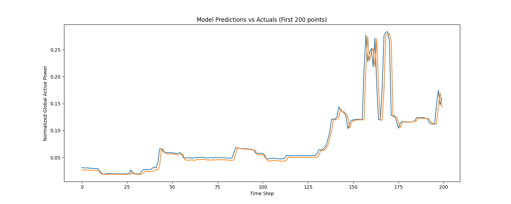

# ⚡ Household Power Consumption Forecasting Web App

An end-to-end time-series forecasting application built with **PyTorch and FastAPI** to predict household electricity consumption using historical power-consumption data and time-based features.

The project demonstrates the evolution of a forecasting model, starting with a single feature and progressing toward a GRU model that incorporates temporal information.

---

## 📈 Model Development Journey

### 1. Single-Feature Forecasting

Initially, the model used only one input feature:

- `Global_active_power`

The goal was to learn patterns in historical electricity consumption and predict future power usage based on previous readings.

We experimented with two recurrent neural network architectures:

- **LSTM (Long Short-Term Memory):** Used to learn temporal patterns from sequential power-consumption data.
- **GRU (Gated Recurrent Unit):** Explored as an alternative recurrent architecture for learning sequential patterns.

In this stage, the models relied entirely on historical power-consumption values, without additional calendar or time information.

### 2. Adding Time-Based Features

In the next stage, we extended the model inputs by introducing temporal features derived from the date and time.

The final model uses seven input features:

| Feature | Description |
|---|---|
| `Global_active_power` | Historical household electricity consumption |
| `month_cos` | Cosine-based representation of the month |
| `month_sin` | Sine-based representation of the month |
| `weekday_cos` | Cosine-based representation of the day of the week |
| `weekday_sin` | Sine-based representation of the day of the week |
| `hour_cos` | Cosine-based representation of the hour |
| `hour_sin` | Sine-based representation of the hour |

These features provide the model with information about **when** electricity is being consumed, in addition to **how much** electricity is being consumed.

For example, electricity usage may vary depending on the hour of the day, day of the week, or month of the year.

> **Note:** The sine and cosine features in the current implementation are generated using the existing training formulas. Their implementation should be corrected and the model retrained together if proper cyclic encoding is desired.

### 3. Final GRU Model

The current forecasting model uses a **Gated Recurrent Unit (GRU)** network with a fully connected output layer.

**Model configuration:**
- Input features: 7
- Sequence length: 24 observations
- GRU hidden units: 15
- GRU layers: 1
- Output: Predicted `Global_active_power`
- Feature scaling: Pre-fitted `MinMaxScaler`
- Framework: PyTorch

The model processes a sequence of historical observations containing power consumption and time-based features to estimate the next power-consumption value.

The forecasting application then uses the model iteratively to generate future predictions.

---

## 📊 Prediction & Analytics Dashboard

| **Power Consumption Forecast** | **Dashboard Overview** |
|:---:|:---:|
|  |  |

### Key Highlights

- **Interactive Forecast Visualization:** Displays predicted power consumption using an interactive Chart.js line graph.
- **Date and Time Input:** Allows users to specify the starting date and time for a forecast.
- **Current Power Input:** Allows users to provide the current `Global_active_power` reading.
- **Temporal Feature Engineering:** Incorporates month, weekday, and hour information into model inputs.
- **PyTorch Inference:** Loads the trained GRU model and generates predictions using the saved model parameters.
- **Feature Scaling:** Uses the saved `MinMaxScaler` to maintain consistency with the model's training data.
- **FastAPI Backend:** Provides an API endpoint for processing forecasting requests.
- **Forecast Summary:** Displays useful statistics, including average and maximum predicted power consumption.

---

## 📉 Model Evaluation

To evaluate forecasting performance, the project includes a comparison between actual and predicted power-consumption values.



The evaluation graph compares **200 actual observations with their corresponding predicted values**.

This visualization helps assess how closely the model follows the actual electricity-consumption pattern and highlights differences between observed and predicted values.

---

## 🛠️ Technologies Used

- **Python** — Data processing and model development
- **PyTorch** — LSTM and GRU model development
- **Pandas** — Dataset loading and preprocessing
- **NumPy** — Numerical computations and feature engineering
- **Scikit-learn** — Feature scaling
- **FastAPI** — Backend API
- **Pydantic** — Request and response validation
- **HTML & CSS** — Frontend interface
- **JavaScript** — Client-side interactions
- **Chart.js** — Forecast visualization

---

## 📁 Project Architecture

```text
power_app/
├── app/
│   ├── __init__.py
│   ├── main.py                 # FastAPI application and API routes
│   ├── model.py                # PyTorch model architecture
│   ├── schemas.py              # Request and response validation
│   └── predictor.py            # Model loading, preprocessing, and prediction
├── artifacts/
│   ├── consumption_model.pt    # Trained PyTorch model parameters
│   └── scaler.pkl              # Saved MinMaxScaler
├── static/
│   ├── style.css               # Frontend styling
│   ├── screenshot_prediction.png
│   ├── screenshot_dashboard.png
│   └── camparasion.png         # Actual vs predicted comparison
├── templates/
│   └── index.html              # Forecasting dashboard
├── data/
│   └── household_power_consumption.txt
├── requirements.txt            # Python dependencies
└── README.md
```

---

## 🚀 How the Application Works

1. The user enters a date and time and provides the current `Global_active_power` reading.
2. The FastAPI backend validates the submitted values.
3. The predictor loads historical power-consumption data from the dataset.
4. The application prepares the historical sequence and calculates the required time-based features.
5. The saved `MinMaxScaler` transforms the model inputs.
6. The trained GRU model predicts power consumption.
7. The application iteratively generates future predictions.
8. The frontend displays the forecast in a graph and table.

---

## 🎯 Project Objective

The primary objective of this project is to investigate how time-series forecasting can be developed from a simple, single-feature model into a model that incorporates temporal information.

The development process follows three main stages:

1. **Single-feature LSTM:** Predict power consumption using historical power readings.
2. **Single-feature GRU:** Explore an alternative recurrent architecture for power forecasting.
3. **Time-feature GRU:** Extend the input from one feature to seven features by adding month-, weekday-, and hour-based information.

This progression provides a practical demonstration of recurrent neural networks, feature engineering, time-series forecasting, and deployment through a web application.

---

## ⚠️ Important Note About Forecasting

The sequence length of 24 observations does not automatically mean that the model predicts 24 hours ahead. The forecast interval must match the sampling frequency used during training.

Because the original household power-consumption dataset contains minute-level readings, verify whether the data was resampled before training. If the model was trained on minute-level data, its sequence and forecast timestamps must reflect that frequency. If it was trained on hourly data, hourly forecasting may be appropriate.

For reliable evaluation, the actual and predicted values should also be compared using the same timestamps and preprocessing procedure.
